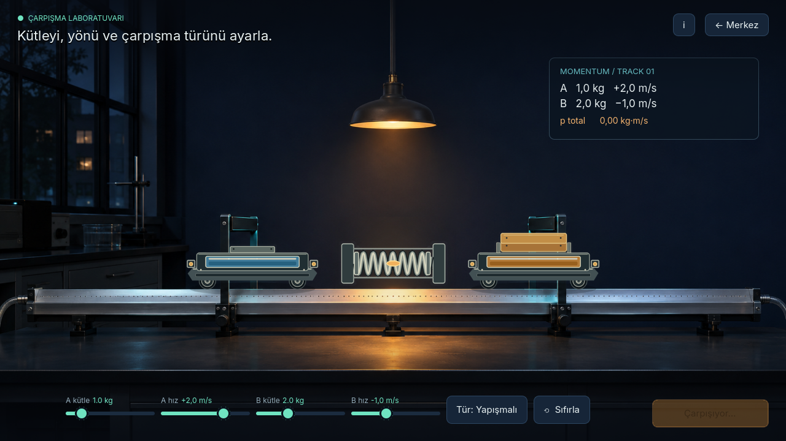
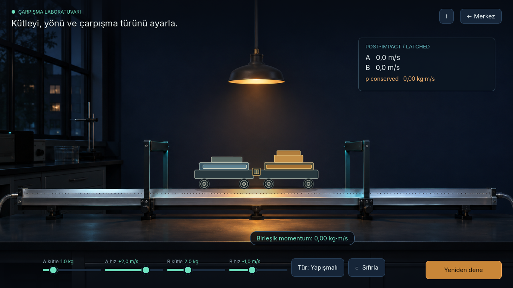

# Collision station scene QA

- Entry scene: `stations/collision/mission.tscn`.
- Run in Godot 4.7.2 with `Godot --path . --rendering-method gl_compatibility --resolution 1280x720 --scene res://stations/collision/mission.tscn`.
- Controls adjust both masses and signed velocities; positive velocity points right and negative points left. Toggle elastic or inelastic mode, then collide or reset.
- The mission calls `collision_sim.gd` for total momentum and post-impact velocities. Simulation formulas were left unchanged.
- Verified import with `Godot --headless --editor --path . --import --quit` and a GUI launch of the mission scene (`--quit-after 120`); both completed without scene/script errors.
- Captures below came from the running mission scene at 1280×720 using Godot 4.7.2 / GL Compatibility.

