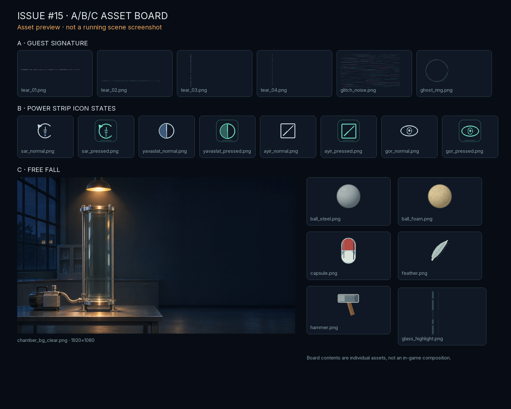
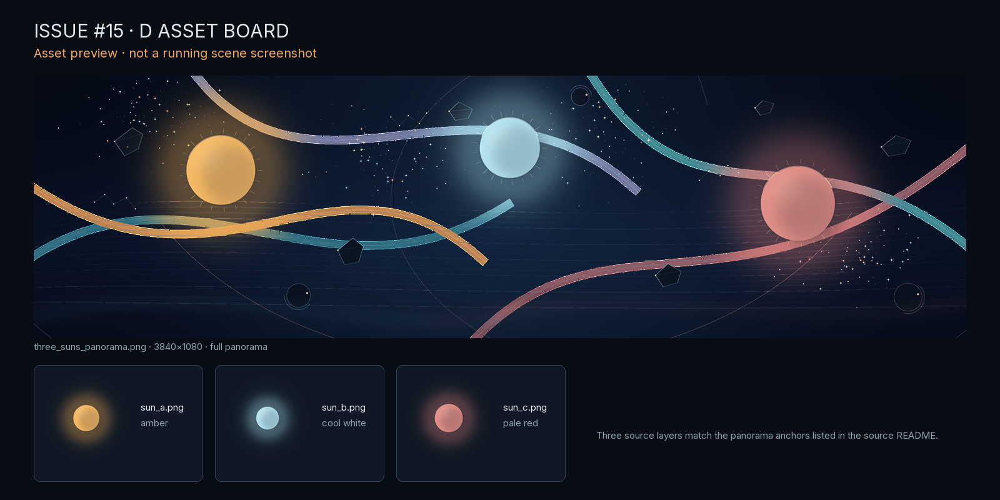

# Issue #15 · Asset delivery

The branch contains all four sections from the request. These are assets and review boards; there is no running story/Free Fall scene in this asset package, so no scene screenshots are available.

## A · Guest signature

`assets/world/signature/`

| File | Dimensions / mode | Bytes |
|---|---|---:|
| `tear_01.png` | 1920×1080 RGBA | 11,881 |
| `tear_02.png` | 1920×1080 RGBA | 11,540 |
| `tear_03.png` | 1920×1080 RGBA | 14,254 |
| `tear_04.png` | 1920×1080 RGBA | 13,820 |
| `glitch_noise.png` | 1920×1080 RGBA | 16,963 |
| `ghost_ring.png` | 512×512 RGBA | 3,633 |

## B · Power strip icons

`assets/ui/powers/`; all 96×96 RGBA.

| Glyph | Normal | Pressed |
|---|---:|---:|
| `sar` | 464 B | 639 B |
| `yavaslat` | 521 B | 641 B |
| `ayir` | 442 B | 569 B |
| `gor` | 559 B | 711 B |

## C · Free Fall scene parts

`stations/free_fall/assets/`. Existing issue #4 / PR #11 files are retained. The additional clear plate uses the existing `chamber_bg.png` as a read-only source; SHA-256 `3205fa053ee59eba5967813e75be2dae9e51a5381dbcf543679ac6c339e26865`. Its generator is `tools/generate_story_assets.py` and defaults to the repository copy of the #11 source image.

| File | Dimensions / mode | Bytes |
|---|---|---:|
| `ball_steel.png` | 256×256 RGBA | 37,198 |
| `ball_foam.png` | 256×256 RGBA | 39,496 |
| `capsule.png` | 256×256 RGBA | 1,691 |
| `feather.png` | 256×256 RGBA | 2,349 |
| `hammer.png` | 256×256 RGBA | 1,115 |
| `glass_highlight.png` | 160×600 RGBA | 2,821 |
| `chamber_bg_clear.png` | 1920×1080 RGB | 1,481,459 |

## D · Three Suns sky

`assets/world/three_suns/`. `three_suns.png` and `three_suns_panorama.png` are retained aliases of the 3840×1080 RGBA panoramic composition. Each individual transparent layer is 1024×1024 RGBA.

| File | Dimensions / mode | Bytes |
|---|---|---:|
| `three_suns_panorama.png` | 3840×1080 RGBA | 657,753 |
| `three_suns.png` | 3840×1080 RGBA | 657,753 |
| `sun_a.png` | 1024×1024 RGBA | 135,490 |
| `sun_b.png` | 1024×1024 RGBA | 133,485 |
| `sun_c.png` | 1024×1024 RGBA | 140,118 |

## Sources, reproduction, and checks

- A/B/C are generated by `python3 tools/generate_story_assets.py`; Pillow is the only dependency. They use original Pillow geometry, gradients, and deterministic material texture. The clear chamber variant reads the existing main-branch chamber background and never writes to it.
- D is generated by `python3 assets/world/three_suns/generate.py`; its README documents the seed, layer anchors, and original Pillow construction. No external imagery or AI output is used in either generator.
- All dimensions, color modes, and file names were verified with Pillow. Godot 4.7.2 headless editor import completed successfully. Both asset boards below are previews, not scene screenshots.

## Asset boards

