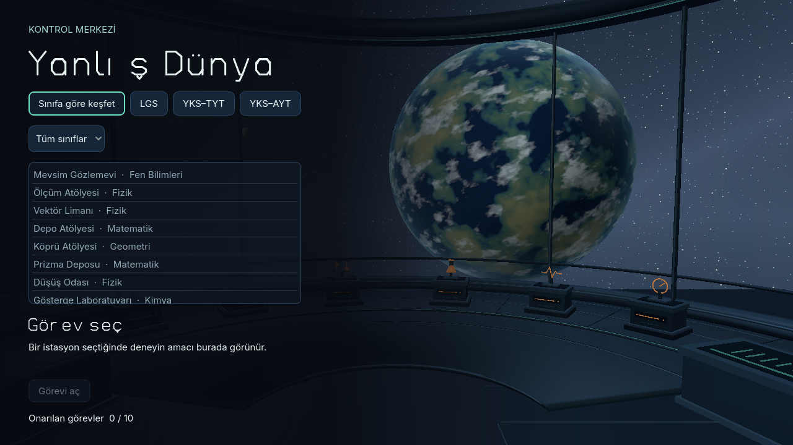
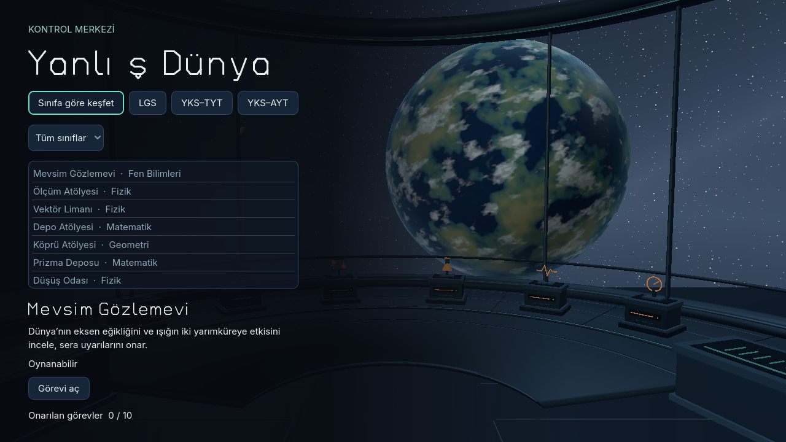
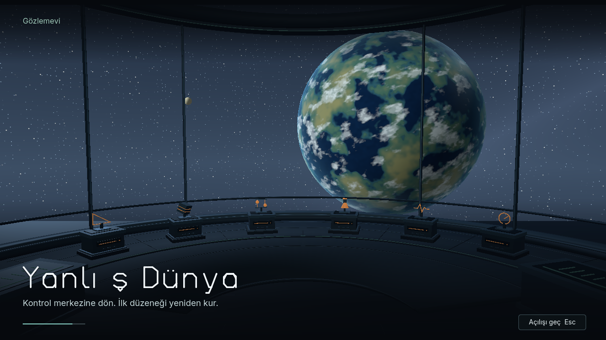

# Meridian runtime type integration

The Meridian display face is used for the control-center title, selected mission title, play-screen title, and intro headlines. Compact section labels use the theme's Inter SemiBold role; instructions and controls inherit Inter. This keeps the custom display face on short titles and uses the licensed body face for readable copy.

`scenes/control_center.tscn` and `scenes/intro/intro.tscn` are captured from the running control center and opening. The first view shows the station list; the second shows a selected mission title; the third shows the intro title cue. Recreate them with Godot 4.7.2 and a GPU renderer:

```sh
godot --path . --script res://tools/capture_meridian_runtime.gd
```

The typeface is the hand-drawn Meridian asset in `assets/fonts/YanlisDunyaMeridian-Display.ttf`; legacy and prior font iterations remain in their existing archive folders.






