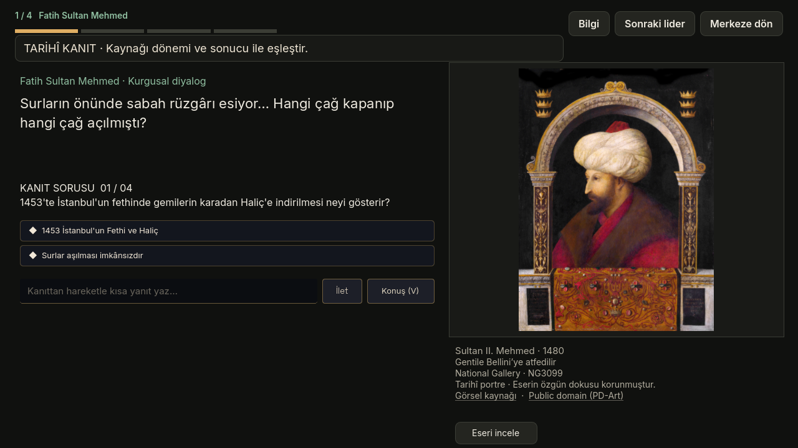
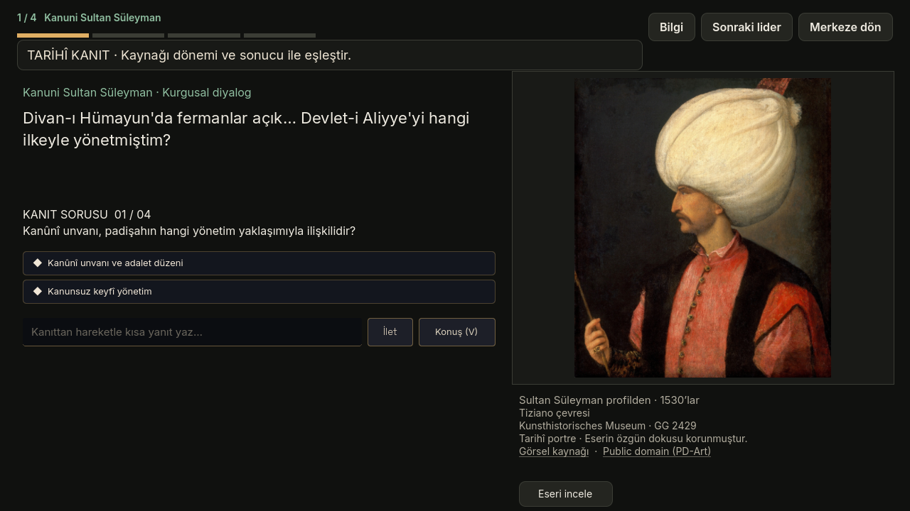
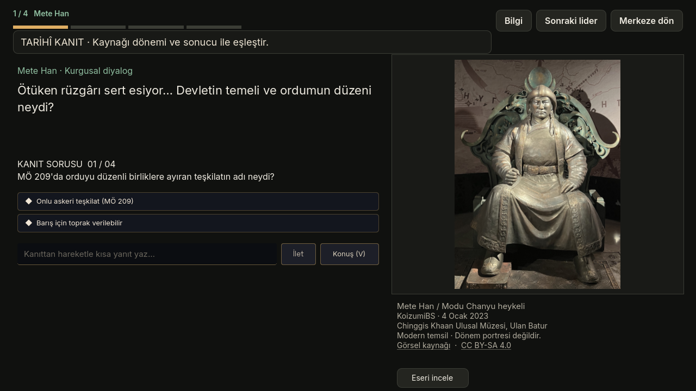
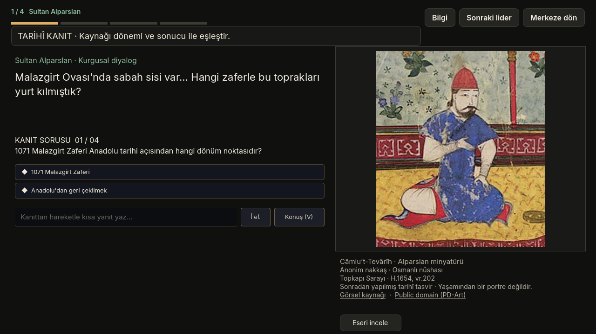
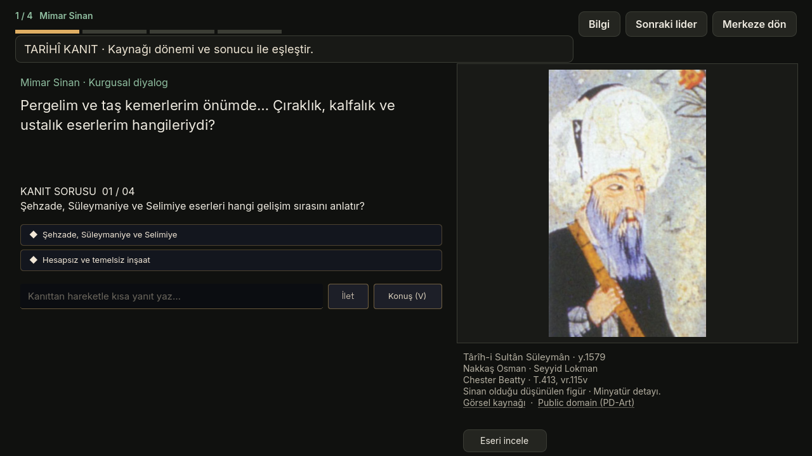
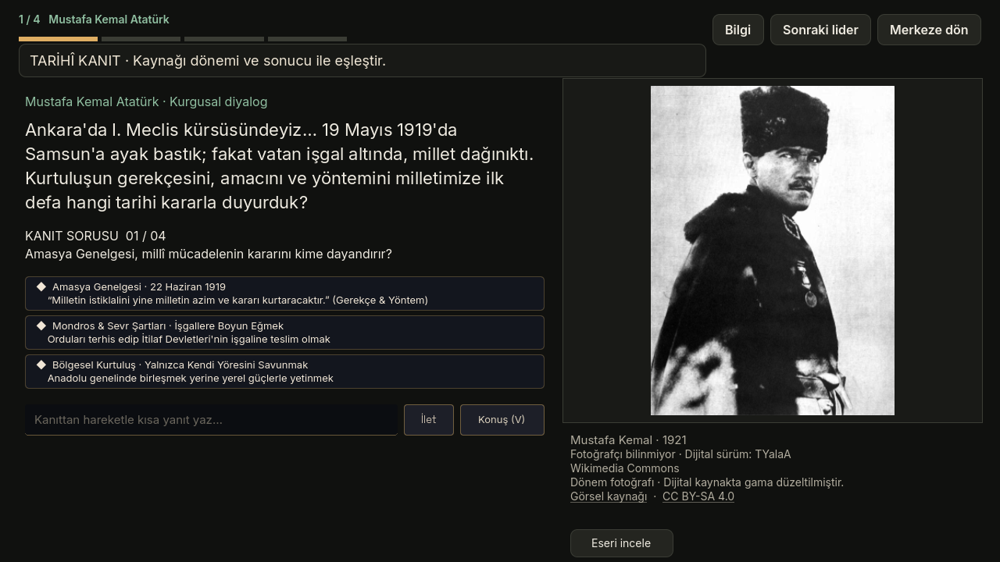
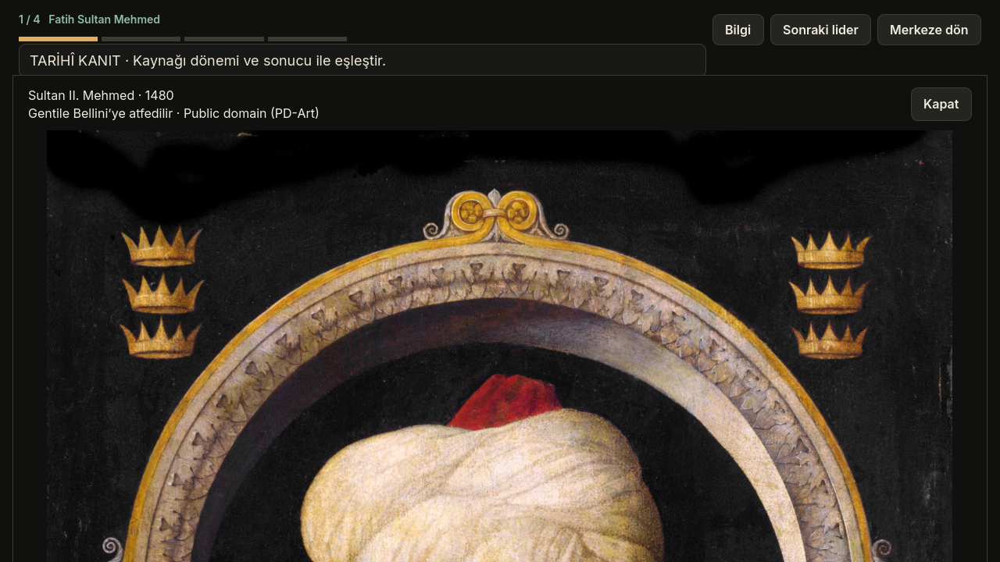
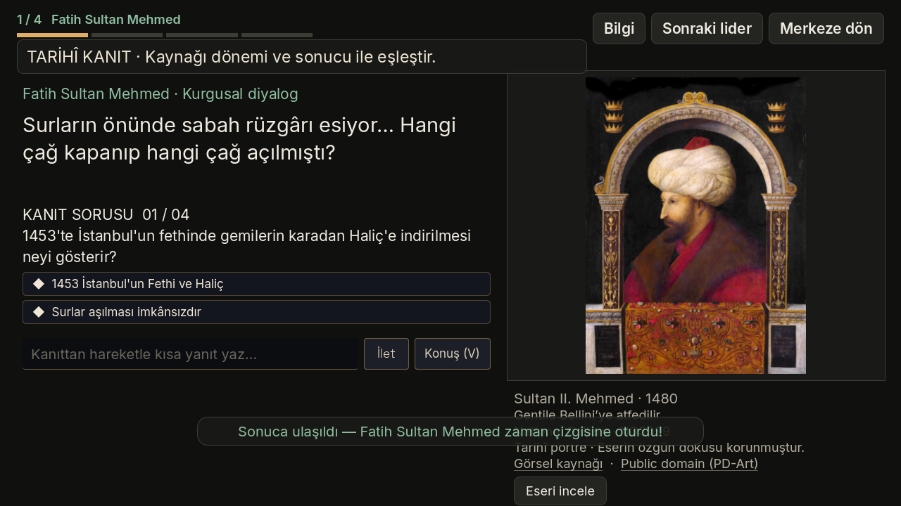
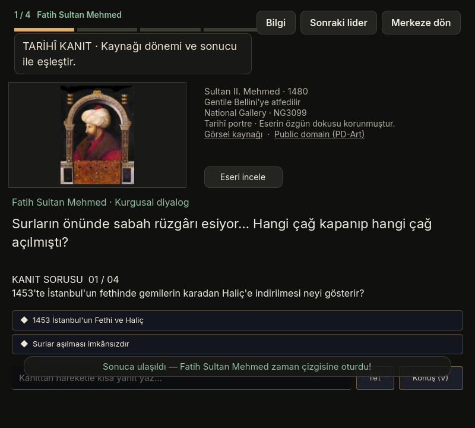

# Tarih Meydanı · Görsel düzeltme · 14 Kasım 2026

Güncel `origin/main` (`ddf7a45`) üzerine uygulanmıştır. Tarihî kişi görselleri ve bunların sunumu bu değişikliğin kapsamıdır; görev soruları ve değerlendirme kuralları korunur.

Altı şahsiyetin üretilmiş yüzleri, ifade yamaları ve arka planı silinirken kaybolan koyu kıyafetleri kaldırıldı. Kaynak eserler yeniden çizilmeden, özgün JPEG dosyalarıyla kullanılıyor. Altı arka plan da kaldırıldı: başka mekânlardan türetilen avlu/kütüphaneler tarihî yapı olarak sunulmuyor. Kaynak ve lisans ayrıntıları [ASSET_SOURCES.md](ASSET_SOURCES.md) içinde.

Portreye oyun durumuna bağlı renk, kararma, nefes hareketi veya alfa geçişi uygulanmaz. Ayrılma animasyonu devam ederken “Yeniden Dene” seçilirse eski tween iptal edilir. Künye ve kaynak bağlantıları canlı metindir. “Eseri incele” kaynak dosyanın tamamını oranını koruyarak açar; müze heykelinin ana sahnedeki detay kadrajı da buradan bütünüyle incelenebilir.

Mete Han heykeli açıkça modern temsil, Alparslan minyatürü sonradan yapılmış tasvir, Sinan minyatüründeki kişi ise Sinan olduğu düşünülen figür olarak etiketlenir. Kurgusal oyun diyalogları gerçek alıntı gibi gösterilmez.

## Kontrol

- `python3 stations/history/tools/build_history_assets.py`: altı kaynak dosyanın SHA-256 değerleri ve künyeleri doğrulandı.
- Godot 4.7.2, OpenGL Compatibility, Apple M4 Pro: proje importu hatasız tamamlandı.
- `Godot --path . --rendering-method gl_compatibility --script res://stations/history/tools/review_assets.gd`: **0 hata**. Altı görselin yüklenmesi, kadraja sığması, oyun durumundan etkilenmemesi, tam kaynak incelemesi, yanlış/doğru karar akışı ve yeniden deneme kontrol edildi. Kontrol betiği TTS/LLM isteği yapmaz.
- 1280×720, 800×720 ve %130 yazı boyutunda ekranlar incelendi. Dar ekranda kontroller kaydırılır; resim ve kaynak ayrı alanda kalır. Kaynak künyesi gerektiğinde kendi alanında kaydırılabilir.
- `git diff --check`: temiz.

## Oyun içinden ekranlar

`review/.gdignore`, bu kontrol görsellerinin oyuna varlık olarak aktarılmasını önler.
