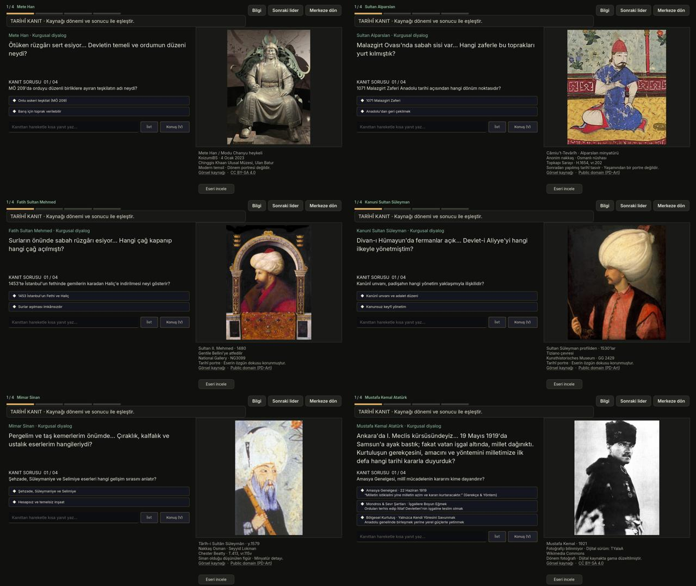
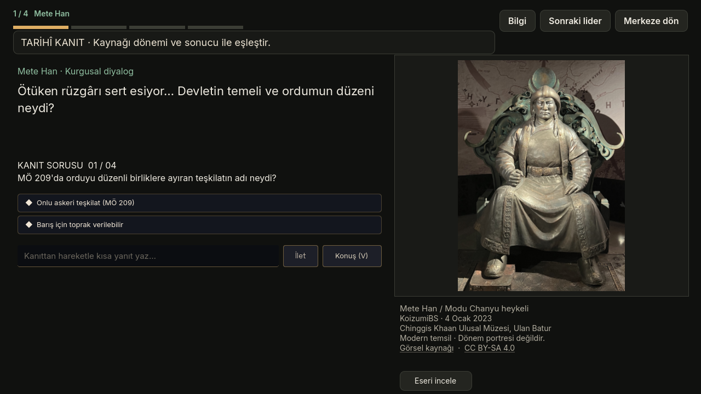
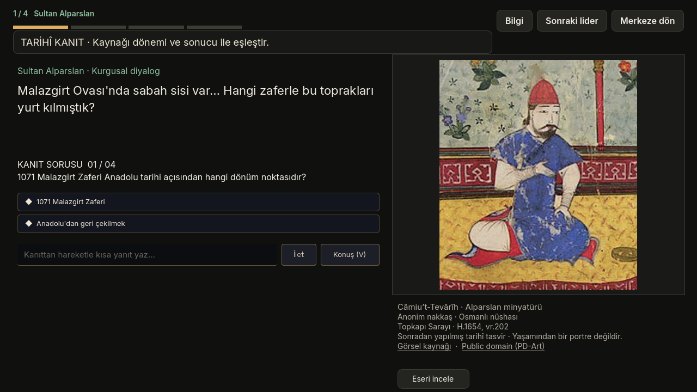
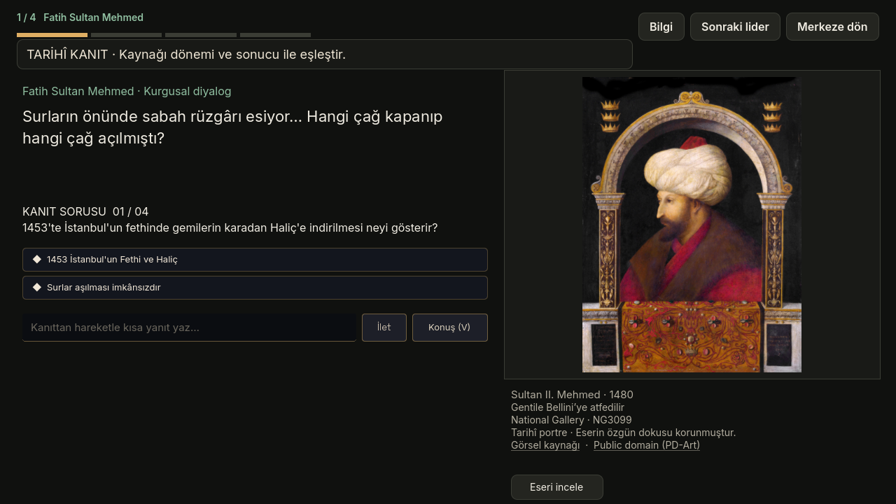
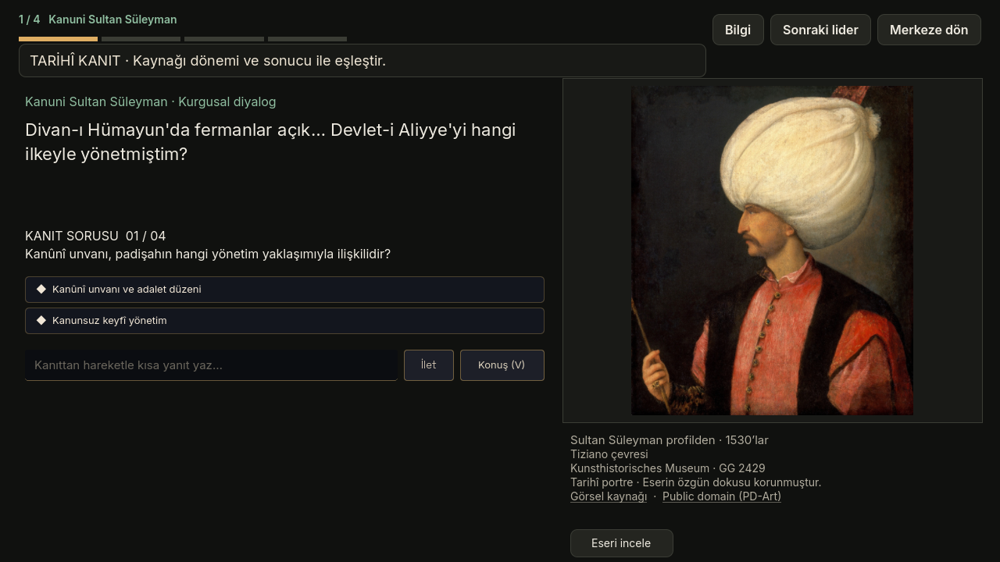
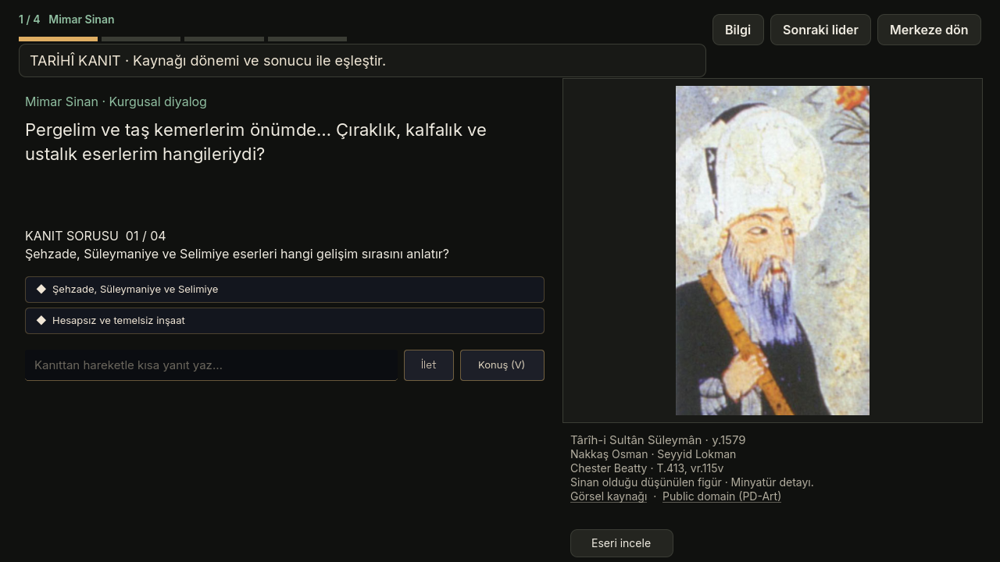
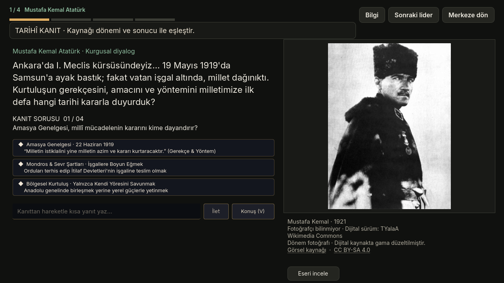

# Tarih görselleri · PR #41 teslim seti

Kullanıcının tekrar gönderilmesini istediği altı görsel ve oyun içi önizlemeler. Önceki [PR #41](https://github.com/yasinkaya701/glitch-academy/pull/41) birleştirilmiş, sonrasında ana dalda canlı figür sunumu tercih edilmiştir. Bu paket güncel `main` (`50106c3`) üzerine yalnızca referans dosyaları ekler.

**Güncel sahne kodu, ses sistemi, portreleri ve karakter manifesti değiştirilmez.** `preview/` görselleri #41 arşiv tasarımına aittir; mevcut ana dalın ekran görüntüleri değildir. `.gdignore` paketin oyuna otomatik aktarılmasını önler.

## Dosyalar

- `images/`: altı özgün kaynak JPEG; yeniden çizim veya alfa kesimi yok.
- `manifest.json`: kişi, kaynak bağlantısı, sanatçı, koleksiyon, lisans, boyut ve SHA-256.
- [SOURCES.md](SOURCES.md): görsel bazında kaynaklar ve temsil sınırları.
- `preview/`: #41 içinden altı karakter, eser incelemesi, dar pencere ve %130 yazı görüntüleri.

## Kontrol

`python3 stations/history/archive_reference/verify.py` altı dosyanın özgün sağlama toplamlarını ve kaynak/lisans bilgilerinin varlığını doğrular. Oyun koduna ve ağ servislerine erişmez.

## Ayrıntılı önizlemeler

### Mete Han

### Sultan Alparslan

### Fatih Sultan Mehmed

### Kanuni Sultan Süleyman

### Mimar Sinan

### Mustafa Kemal Atatürk

